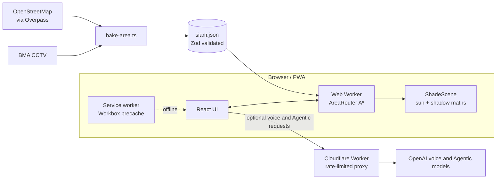

<div align="center">


# Walk We 2

**Shadier walks by day. Safer walks by night. Plan a route around Siam that follows the sun and the data.**

Mobile-first PWA for central Bangkok. No account, works offline, and the routing engine runs on your phone.

[Live demo](https://walkwe-web2.walkwe.workers.dev) ·
[What it does](#what-it-does) ·
[How it works](#how-it-works) ·
[Agentic AI Workflow](#agentic-ai-workflow) ·
[Tech stack](#tech-stack) ·
[Quick start](#quick-start) ·
[Testing](#testing-and-quality) ·
[Data](#data) ·
[Roadmap](#roadmap)

</div>

---

## What it does

Bangkok walks are hot at noon and poorly lit at night. Most map apps pick the shortest path. Walk We picks the path that fits the time of day.

- **Shade by day.** Casts building, tree and elevated-deck shadows for the exact sun position at your departure time, then routes through the shade. Covered malls count only if they will still be open when you arrive.
- **Safer by night.** Weights each street by lighting, CCTV coverage, night foot traffic (from nearby open shops and points of interest) and recorded incidents. The wording is always "safer (based on available data)". The app never promises safety, and a unit test fails if a bare "safe" appears in the UI.
- **Three routes per trip.** Shadiest or safest, balanced (at most 1.25× the shortest), and shortest as the baseline. Routes that are not meaningfully different are merged into one card.
- **Turn-by-turn on the phone.** Works in airplane mode and resumes on the same step after a reload. Photo guides replace plain steps where a hand-made guide exists.
- **Voice.** Dictate a place with the browser microphone, and hear instructions in the browser voice or OpenAI speech, and speak to GPT-Live in Thai and English.
- **Accessibility.** Step-free routing, larger text, vibration on each step, read-aloud, and 48 px touch targets. axe-core WCAG 2.1 AA scans run in the Playwright E2E tests in day and night themes.
- **SOS.** Hold for 1 second, then a 5 second countdown shares your location by SMS or LINE. Contacts stay on the device.
- **Private by design.** No accounts and no analytics. Location is never logged, and the error reporter strips coordinates.

---

## How it works



**One route request, step by step**

1. `bake-area.ts` turns OSM and BMA CCTV into a single dataset. Building heights are tagged by source (`height`, `levels × 3 m`, per-type default, 10 m fallback).
2. The Web Worker validates the dataset with Zod, projects it into local metres, and builds a CSR walk graph. Each edge is split into about 10 m segments.
3. For each request it reads the sun position (SunCalc) at departure, the cloud factor (Open-Meteo), mall opening hours, and incident weights (half-life 1 year).
4. A\* runs once per profile with this cost:
   - Day: `length × (1 + w_sun × cloud × sun-exposed share + w_inc × incident)`
   - Night: `length × (1 + w × risk(chosen factors) + w_inc × incident)`
5. Shade is computed lazily. Only the edges A\* touches are evaluated, and the result is memoised per sun position.
6. The result becomes map runs (solid for shade or better cover, dashed for sun or less cover), stats, and turn-by-turn steps.

Shade accuracy was regression-tested against the earlier prototype on identical input: mean per-edge difference of 0.002 for the shared maths. The remaining difference comes from the new permanent-shade layer, which covers points under BTS and expressway decks and under tree crowns. See [`docs/shadow-regression.md`](docs/shadow-regression.md).

### Architecture

```
apps/web2        React + Vite PWA (UI only)
packages/core    routing, shadow, sun, scoring + adapter interfaces. Pure TypeScript, runs in Node and in a Worker
packages/data    Zod schemas (mirror future PostGIS tables) + dataset loaders
config/cities    per-city settings: time zone, bounds, emergency numbers, data sources
apps/ai-proxy    Cloudflare Worker for optional speech and evidence ranking (see AI_USAGE.md)
packages/walkwe-agentic   Local Agentic workflows, Worker, MCP and evals
packages/verify          Deterministic checks against route evidence
packages/voice-research  Async public street evidence research and review drafts
```

Dependencies point one way: `apps/web2 → packages/data → packages/core → config`. Core never imports the browser or the data package.

**Adapters** let a service change without touching the UI. They are wired up in one file, `apps/web2/src/services.ts`.

| Interface | Today | Later |
|---|---|---|
| `GeocoderAdapter` | Photon | self-hosted Photon, Longdo, Google |
| `RoutingEngine` | `AreaRouter` in a Web Worker | server endpoint or GraphHopper with custom weighting |
| `DataRepository` | static JSON | API backed by Postgres/PostGIS |
| `PlatformAdapter` | browser (geolocation, share, vibrate, wake lock) | Capacitor plugins |
| `CloudCoverProvider` | Open-Meteo | any forecast API |
| `LiveShareService` | interface only | Supabase Realtime with expiring links |

More detail, including how to scale to the whole city and add another city, is in [`ARCHITECTURE.md`](ARCHITECTURE.md).

---

## Agentic AI Workflow

### Plan and verify a walk

1. **Capture and confirm intent.** A typed or spoken Thai or English request becomes an editable draft with start, destination, Bangkok departure time, day or night mode, and stair preference. Optional GPT‑6.1 Terra extraction is scoped to the public place catalogue. The local parser and form handle unavailable models and fields that need clarification. The walker confirms the endpoints before calculating routes.
2. **Calculate routes and gather evidence.** Web2 computes map routes with `AreaRouter` in a Web Worker, including trips from a private pin or GPS. Review of a confirmed public-landmark trip runs independently in the proxy against the versioned Siam graph. It builds a snapshot with candidate IDs, ETA, distance, daytime shade and nighttime lit, dark and unknown distances. The comparison applies the same stair restriction and passage hours to each route. Evidence records identify the segment, source or method, observation date and dataset version. The Agentic review treats lamp proximity as an estimate and excludes stale or future-dated lighting from trusted evidence.
3. **Compare time or lighting assumptions.** The daytime Departure Advisor compares sun exposure at five-minute intervals, up to 30 minutes later, while checking passage hours and any arrival deadline supplied to the workflow. At night the stress test compares treating unknown stretches as lit versus dark. Web2 asks once when the recommendation changes or the suggested route contains unmapped lighting. Answering reruns the review for the same trip and keeps the observed lighting and selected map route intact.
4. **Orchestrate, verify and retry.** The proxy and `createWorkflows()` prepare the trip context and pass the snapshot to Planner (GPT‑6.1 Terra). The harness validates calls such as `get_trip_snapshot`, `get_segment_evidence` and `finish_trip`, tracks which evidence the model read, and checks the draft's route IDs, claims, unknowns and numeric placeholders. Code fills the placeholders from checked metrics. Critic (GPT‑6.1 Sol) checks claims against the same evidence when the lighting stress test changes the winner or another candidate is within two minutes. Rejected drafts can return to Planner within six Planner steps, eight tool calls, two rejected finishes and a shared 20-second deadline.
5. **Return a review with its source.** The proxy serves a JSON result or streams NDJSON progress for routing, evidence and verification, including Critic when invoked. The result identifies its source as `verified_planner` or `worker`, and Web2 explains that source alongside the metrics. Provider errors, verification failures and exhausted budgets fall back to deterministic route text. Segment highlights remain available from the routing data, and the optional ranking endpoint can reorder the supplied highlights. The walker chooses the route used for navigation.

The routing decision is `ACT` when the comparison produces a stable recommendation, `VERIFY` when the night recommendation changes with the lighting assumption, or `ABSTAIN` when the review cannot produce an eligible route. The app can ask about unmapped lighting even when both assumptions produce the same recommendation. Recommendations describe conditions based on available data.

### Context, retrieval and memory

| Layer | What it handles |
| --- | --- |
| **Context Engineering** | Builds bounded input from confirmed public IDs, Bangkok departure, language, walking constraints and a single dataset snapshot. User text, public excerpts and tool results enter as data. The Intent context masks supported patterns for links, contact details and coordinates before model extraction. |
| **Evidence retrieval** | Route tools read metrics and segment provenance from the current graph snapshot. Segment Research uses public web sources for a separate review queue. |
| **CAG (Cache-Augmented Generation)** | The Responses client records provider prompt-cache usage. A dedicated CAG prefix for stable routing guidance is a follow-up. Route evidence comes from the graph snapshot for each trip. |
| **Trip memory** | Navigation restores the active trip from device storage. The standalone Worker uses an expiring continuation for a single trip. Long-term Memory-Augmented Generation (MAG) is outside the current runtime. |

[Context, retrieval and caching](docs/agentic/ARCHITECTURE.md#context-retrieval-and-caching)

### Voice Agent, navigation and SOS

- **Live conversation.** The walker starts an opt-in WebRTC session with `gpt-live-1.1`, which delegates to `gpt-6.1-terra`. Web2 validates actions against the current screen and state. The same session can draft a trip, find routes after confirmation, review evidence, answer the lighting question and select an offered route. On later screens the walker can ask about the active trip, hear a navigation step, open share or SOS controls, or answer the arrival lighting question. The app stores the arrival answer on-device.
- **Checked speech.** For route and navigation playback, the app supplies the checked text and figures to `gpt-realtime-2.1-mini`. The proxy releases audio after its transcript matches the requested wording. Device speech covers unavailable or mismatched audio. Browser dictation stays available independently of hosted speech. The Live microphone pauses during action handling and playback, and the session has a two-minute limit.
- **Trip Companion.** Closure, nightfall or missing lighting can prompt a warning or replan offer during navigation. The proxy also accepts a rain event from a trusted integration. The workflow tracks handled events and shows at most two notices per walk. The walker confirms a route change.
- **SOS and sharing.** Voice opens the existing controls. The app lets the walker share manually, rehearse the SOS flow, or confirm delivery through the optional authenticated relay after a cancellable countdown. The relay checks the confirmed recipient, deduplicates sends, and tracks provider acceptance and recipient acknowledgement independently. Practice runs use the simulator.

### Evidence collection and human approval

| Workflow | Intake and result |
| --- | --- |
| **Evidence Steward** | Corroborated night-lighting observations from distinct authenticated reporters and consented, scrubbed photo labels enter the evidence queue as drafts. |
| **News Scout** | A trusted submitter provides a public excerpt, source URL and permitted segment IDs. Structured extraction proposes the incident type, dates and segment match for review. |
| **Public Segment Research** | The night route evidence panel submits a selected public edge and graph version. GPT‑6 Astra looks up public sources in an asynchronous job. A browser capability scopes polling, and the draft enters `pending_review` for a reviewer. |
| **Human review** | An authorized reviewer approves or rejects the current draft revision. The queue records the decision and an audit trail. Fresh approved lighting can fill an unknown edge on the matching graph version. News, photo labels and web research remain attributed review records. |

[Evidence review and research API](packages/voice-research/README.md)

### Runtime and integration points

| Surface | Contract |
| --- | --- |
| **Web2 and Cloudflare proxy** | `/agentic/intent`, `/agentic/plan` and `/agentic/companion` handle app requests. `/route-evidence` ranks existing highlights. `/voice/live` opens the session and `/voice/live/speak` returns checked audio. `/sos` handles the relay. Hosted model calls depend on Worker secrets, the configured origin and rate limits. |
| **Evidence and SOS storage** | `/evidence/*` and `/agents/research` use authenticated service identities. The proxy config declares SQLite-backed `EVIDENCE_QUEUE` and `SOS_OUTBOX` Durable Objects. |
| **Node preview and standalone Worker** | The local preview serves `/api/*` with either fixtures or the public Web2 graph. The authenticated `/agent/step` contract uses an expiring continuation for one tool call at a time. The host checks any proposed finish before displaying it. |
| **Read-only MCP** | `get_segment_evidence`, `replay_demo_trip` and `compare_departure_times` use the named fixture or Web2 dataset version over stdio. The tools support inspection and replay in Codex or Claude. |

The [Agentic package](packages/walkwe-agentic/README.md) documents the local tools and model-free fallback. The [workflow architecture](docs/agentic/ARCHITECTURE.md) covers the host contract and service settings. The [Dot handoff](packages/walkwe-agentic/DOT.md) records the team assistant's role in tracking acceptance and blockers.

### Verification and rollout

The local suites exercise routing and evidence, successful and rejected Planner drafts, the Critic retry path, provider fallbacks, voice tool validation, evidence approval and simulated SOS. The offline eval covers 34 fixture cases and 18 mocked-provider cases. The recorded live eval from the earlier sandbox commit passed 10 of 12 cases. All ten Intent cases passed, and both Planner cases used the deterministic fallback after hitting the deadline before Critic ran. [Recorded OpenAI eval](docs/agentic/EVAL_2026-11-21_RERUN.md)

Staging verification covers a real Thai microphone session through the lighting answer and checked playback, deployed evidence approval and confirmed SOS delivery to an enrolled recipient. [Deployment and integration status](docs/agentic/ARCHITECTURE.md#deployment-and-integration-status)

---

## Tech stack

| Layer | Technology | Why |
|---|---|---|
| UI | React 18, React Router 7, Framer Motion | Lazy-loaded routes keep the landing page in the main bundle only |
| Build | Vite 8, TypeScript 5.9 (strict), npm workspaces | One monorepo, one typecheck and test run |
| Map | MapLibre GL 6, OpenFreeMap vector tiles (positron day, dark night) | Free and keyless. Positron has 55 layers against 111 for liberty, which saved about 2 s of main thread on a mid-range phone |
| Routing | Custom A\* on a CSR graph with a binary heap, in a Web Worker | The UI thread never blocks and no server is needed |
| Shade | Own shadow engine over SunCalc: building, tree and deck geometry, permanent-shade layer, lazy per-edge exposure | Reproduces the prototype within 0.002 mean difference |
| Data validation | Zod | Same schemas will mirror the future PostGIS tables |
| Offline | vite-plugin-pwa, Workbox | Precaches the shell, dataset (about 8.2 MB raw, 1.3 MB gzip), guides and incidents. Navigation also prefetches photos, map styles, glyphs and tiles along the route |
| Geocoding | Photon (komoot) behind an adapter | Swappable without UI changes |
| Weather | Open-Meteo cloud cover | Free and keyless. Cloud cover scales the sun penalty |
| Speech | Web Speech API, GPT-Live and OpenAI Realtime through a Cloudflare Worker | Browser voice fallback and hosted voice on the configured origin |
| Edge | Cloudflare Workers (static assets and proxy), Workers Rate Limiting | Per-client and global limits, origin and Fetch Metadata checks, request text kept out of logs |
| Security | Strict CSP with a hashed inline script, HSTS, `frame-ancestors 'none'`, Permissions-Policy | Header test checks the hash against `index.html` |
| Test | Vitest, Playwright, axe-core, Lighthouse | See below |
| CI | GitHub Actions | Typecheck, unit tests and build on every push and pull request |

### Engineering decisions worth noting

- **Computation on the device.** The whole pilot area runs in a Web Worker, so the app has no routing server, no per-request cost, and keeps working offline.
- **Pure core package.** `packages/core` has no DOM access, so the same code runs in Node for tests and baking scripts, and in the Worker for users.
- **Honest data.** Every dataset layer records its source, license and update time. Estimates (97% of building heights, street lighting) are flagged in the UI and listed on a Data limitations page.
- **Safety outranks shade.** A street with a recent incident costs far more than walking in the sun.
- **Spend protection.** The speech proxy checks origin and Fetch Metadata, limits 20 requests per minute per client and 120 per minute overall, and caps text at 300 characters.

---

## Testing and quality

| Check | Scope |
|---|---|
| Unit (Vitest), 178 tests in 34 files | Sun and shadow maths (including the brief's 67° and 36 m checks), routing profiles, mall hours, night factors, incidents, steps, guide matching, schemas, SOS state machine, messages, token contrast, wording rules, CSP hash, speech Worker |
| E2E (Playwright) | Full flow, offline navigation with reload, SOS, sharing links, 48 px targets, 200% text, on iPhone SE, iPhone 15 and Pixel 7 sizes |
| Accessibility | axe-core WCAG 2.1 AA in day and night themes |
| Performance | Lighthouse mobile on every screen, simulated slow 4G with 4× CPU. Every screen scores 90 or more (92 to 93 at the time of writing) |
| Real devices | [`TESTING_CHECKLIST.md`](TESTING_CHECKLIST.md) |

Animations use transform and opacity only, last 300 ms or less, and respect `prefers-reduced-motion`.

---

## Quick start

Requires Node 22 or newer.

```bash
npm ci
npm run dev          # http://localhost:5174
npm test             # unit tests (Vitest)
npm run typecheck
npm run build
npm run preview      # http://localhost:4175
npm run test:e2e     # Playwright on three phone sizes (builds first)
npm run lighthouse   # mobile Lighthouse on every screen, fails below 90 (needs CHROME_PATH)
npm run photos       # rebuild route photo variants after adding real photos
```

First E2E run: `npx playwright install chromium` inside `apps/web2`.

### Agentic development

`npm run agentic:web2` runs the local Agentic API with the Web2 Siam graph.
Run `npm run test:agentic`, `npm run test:agentic:web2` and `npm run eval:agentic`
for the offline workflow, routing integration and eval suites. See the
[Agentic architecture](docs/agentic/ARCHITECTURE.md) and
[OpenAI live eval report](docs/agentic/EVAL_2026-11-21_RERUN.md).

Web2 shows segment evidence directly from the route Worker. The optional
`POST /route-evidence` action reorders these highlights when the same proxy has
the `OPENAI_API_KEY` Worker secret and both existing rate limit bindings.
Requests contain candidate numbers, categories and distances. Map evidence
remains available when the proxy or OpenAI is unavailable.

### Optional hosted voice and research

Set `OPENAI_API_KEY` as a Worker secret. Set `ALLOWED_ORIGINS`, `OPENAI_LIVE_ORIGIN` and `OPENAI_AGENTIC_ORIGIN` to the approved Web2 origin. Set `WALKWE_DATA_ORIGIN` to the deployment that serves its graph files. The Wrangler configuration binds the rate limiters and evidence queue. See the [architecture and service settings](docs/agentic/ARCHITECTURE.md).

Build with `VITE_AI_PROXY_URL=<worker url> npm run build`. For local development, set the origins and key in `apps/ai-proxy/.dev.vars`, set `WALKWE_DATA_ORIGIN=http://localhost:5174` and run `npm run ai:dev` alongside `VITE_AI_PROXY_URL=http://localhost:8788 npm run dev -- --port 5174`.

The browser voice reads directions if hosted speech is unavailable. In night route results, choose a named segment with missing lighting data to look up public sources. Results wait for a reviewer in the evidence queue.

### Configuration

External URLs come from env (`apps/web2/.env.example`): MapLibre styles (OpenFreeMap), the Photon geocoder, Open-Meteo, and an optional error-tracking endpoint. The public Photon server is fair-use and meant for development. Point production at a self-hosted instance before launch.

---

## Data

The pilot covers central Bangkok around Siam, bounding box `[100.505, 13.725, 100.565, 13.768]` (about 6.5 × 4.8 km, about 11k walkways and 33.6k buildings). Walks are capped at 5 km at 4.5 km/h.

```
data/areas/siam.json                pilot dataset (OSM + BMA CCTV), served at /data/areas/siam.json
data/areas/siam-prototype.json      prototype bake, imported for regression only (not served)
data/routes/siam-centralworld.json  photo guide (both directions) + data/routes/photos/
data/incidents/bangkok.json         past incidents by OSM way id; placeholder entries are dev-only
data/precomputed/                   generated shade tables (git-ignored)
```

Layers: walkways, buildings, trees, elevated decks, malls with opening hours, OSM and BMA CCTV, lamps, and points of interest.

```bash
npx tsx packages/data/scripts/bake-area.ts        # re-bake the pilot area (Overpass + BMA, about 2 min)
npx tsx packages/data/scripts/import-prototype.ts # re-import the prototype's siam.json
npx tsx scripts/compare-prototype.ts              # regenerate docs/shadow-regression.md
npx tsx scripts/precompute-shade.ts 2026-10       # per-edge sun exposure every 30 min (also --year 2026)
```

**Route photos:** put real photos in `data/routes/photos/` under the names the guide references (`siam-cw-01.jpg` and so on), then run `npm run photos` to build the AVIF, WebP and JPEG variants with blur placeholders. Until then the app shows labelled placeholders.

**Incidents:** add reviewed entries directly to `data/incidents/bangkok.json`. Each needs `wayIds`, `category`, `occurredOn`, `window`, `severity` and at least one dated `sources` link. The schema rejects any other field, so names cannot be stored. Entries with `placeholder: true` show (labelled) in development and are stripped from builds.

---

## Privacy

Saved places, recent searches, emergency contacts and the walk in progress live in `localStorage` only. There are no accounts. Location is never logged, and it leaves the device only inside links the user taps (LINE, SMS). The optional speech Worker receives only the short text to read aloud, and keeps request text out of its logs.

---

## Roadmap

- [ ] Self-hosted Photon and vector tiles for production
- [ ] Postgres/PostGIS backend and tiled datasets for the whole city
- [ ] Server-side shade precompute per tile, with the on-device engine as fallback
- [ ] Real-time location sharing with "alert if not arrived" (Supabase Realtime)
- [ ] Capacitor app with background location and native share
- [ ] Better building heights (BMA or open LiDAR/DSM) and street lighting data
- [ ] More cities through `config/cities/<city>.ts`

---

## Team

The Walk We team is **Dev**.

- Nathaporn Saituptim, Team Lead / Developer
- Natchapon Thiradechanun, AI Engineer / Developer
- Siriphanaphorn Sirikun, Support

## License and attribution

Map data © OpenStreetMap contributors (ODbL 1.0). The derived dataset `data/areas/siam.json` is ODbL. Fonts: Bai Jamjuree and Sarabun (OFL 1.1). Sponsor logos in `apps/web2/public/sponsors/` are trademarks of their owners. The BMA CCTV layer has no stated license, so commercial use needs BMA permission.
