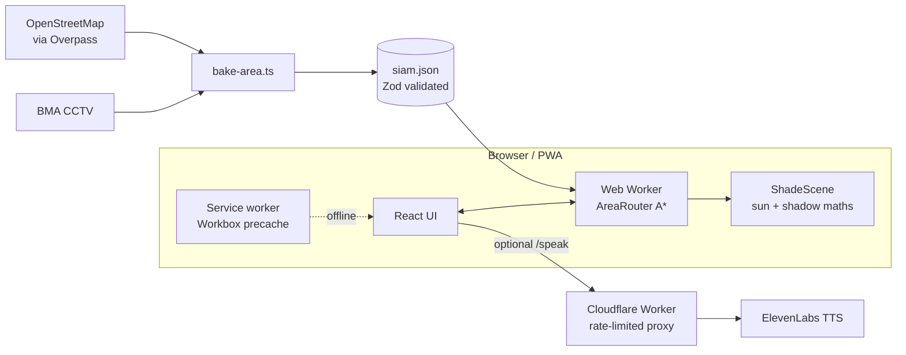

<div align="center">

# Walk We 2

**Shadier walks by day. Safer walks by night. Plan a route around Siam that follows the sun and the data.**

Mobile-first PWA for central Bangkok. No account, works offline, and the routing engine runs on your phone.

[Live demo](https://walkwe-web2.walkwe.workers.dev) ·
[What it does](#what-it-does) ·
[How it works](#how-it-works) ·
[Tech stack](#tech-stack) ·
[Quick start](#quick-start) ·
[Testing](#testing-and-quality) ·
[Data](#data) ·
[Roadmap](#roadmap)

</div>

---

## What it does

Bangkok walks are hot at noon and poorly lit at night. Most map apps pick the shortest path. Walk We picks the path that fits the time of day.

- **Shade by day.** Casts building, tree and elevated-deck shadows for the exact sun position at your departure time, then routes through the shade. Covered malls count only if they will still be open when you arrive.
- **Safer by night.** Weights each street by lighting, CCTV coverage, night foot traffic (from nearby open shops and points of interest) and recorded incidents. The wording is always "safer (based on available data)". The app never promises safety, and a unit test fails if a bare "safe" appears in the UI.
- **Three routes per trip.** Shadiest or safest, balanced (at most 1.25× the shortest), and shortest as the baseline. Routes that are not meaningfully different are merged into one card.
- **Turn-by-turn on the phone.** Works in airplane mode and resumes on the same step after a reload. Photo guides replace plain steps where a hand-made guide exists.
- **Voice.** Dictate a place with the browser microphone, and hear instructions in the browser voice or optional ElevenLabs (Thai and English).
- **Accessibility.** Step-free routing, larger text, vibration on each step, read-aloud, and 48 px touch targets. axe-core WCAG 2.1 AA scans run in the Playwright E2E tests in day and night themes.
- **SOS.** Hold for 1 second, then a 5 second countdown shares your location by SMS or LINE. Contacts stay on the device.
- **Private by design.** No accounts and no analytics. Location is never logged, and the error reporter strips coordinates.

---

## How it works



**One route request, step by step**

1. `bake-area.ts` turns OSM and BMA CCTV into a single dataset. Building heights are tagged by source (`height`, `levels × 3 m`, per-type default, 10 m fallback).
2. The Web Worker validates the dataset with Zod, projects it into local metres, and builds a CSR walk graph. Each edge is split into about 10 m segments.
3. For each request it reads the sun position (SunCalc) at departure, the cloud factor (Open-Meteo), mall opening hours, and incident weights (half-life 1 year).
4. A\* runs once per profile with this cost:
   - Day: `length × (1 + w_sun × cloud × sun-exposed share + w_inc × incident)`
   - Night: `length × (1 + w × risk(chosen factors) + w_inc × incident)`
5. Shade is computed lazily. Only the edges A\* touches are evaluated, and the result is memoised per sun position.
6. The result becomes map runs (solid for shade or better cover, dashed for sun or less cover), stats, and turn-by-turn steps.

Shade accuracy was regression-tested against the earlier prototype on identical input: mean per-edge difference of 0.002 for the shared maths. The remaining difference comes from the new permanent-shade layer, which covers points under BTS and expressway decks and under tree crowns. See [`docs/shadow-regression.md`](docs/shadow-regression.md).

### Architecture

```
apps/web2        React + Vite PWA (UI only)
packages/core    routing, shadow, sun, scoring + adapter interfaces. Pure TypeScript, runs in Node and in a Worker
packages/data    Zod schemas (mirror future PostGIS tables) + dataset loaders
config/cities    per-city settings: time zone, bounds, emergency numbers, data sources
apps/ai-proxy    Cloudflare Worker for optional ElevenLabs speech (see AI_USAGE.md)
packages/walkwe-agentic   Local Agentic workflows, Worker, MCP and evals
packages/verify          Deterministic checks against route evidence
packages/voice-research  Async public street evidence research and review drafts
```

Dependencies point one way: `apps/web2 → packages/data → packages/core → config`. Core never imports the browser or the data package.

**Adapters** let a service change without touching the UI. They are wired up in one file, `apps/web2/src/services.ts`.

| Interface | Today | Later |
|---|---|---|
| `GeocoderAdapter` | Photon | self-hosted Photon, Longdo, Google |
| `RoutingEngine` | `AreaRouter` in a Web Worker | server endpoint or GraphHopper with custom weighting |
| `DataRepository` | static JSON | API backed by Postgres/PostGIS |
| `PlatformAdapter` | browser (geolocation, share, vibrate, wake lock) | Capacitor plugins |
| `CloudCoverProvider` | Open-Meteo | any forecast API |
| `LiveShareService` | interface only | Supabase Realtime with expiring links |

More detail, including how to scale to the whole city and add another city, is in [`ARCHITECTURE.md`](ARCHITECTURE.md).

---

## Tech stack

| Layer | Technology | Why |
|---|---|---|
| UI | React 18, React Router 7, Framer Motion | Lazy-loaded routes keep the landing page in the main bundle only |
| Build | Vite 8, TypeScript 5.9 (strict), npm workspaces | One monorepo, one typecheck and test run |
| Map | MapLibre GL 6, OpenFreeMap vector tiles (positron day, dark night) | Free and keyless. Positron has 55 layers against 111 for liberty, which saved about 2 s of main thread on a mid-range phone |
| Routing | Custom A\* on a CSR graph with a binary heap, in a Web Worker | The UI thread never blocks and no server is needed |
| Shade | Own shadow engine over SunCalc: building, tree and deck geometry, permanent-shade layer, lazy per-edge exposure | Reproduces the prototype within 0.002 mean difference |
| Data validation | Zod | Same schemas will mirror the future PostGIS tables |
| Offline | vite-plugin-pwa, Workbox | Precaches the shell, dataset (about 8.2 MB raw, 1.3 MB gzip), guides and incidents. Navigation also prefetches photos, map styles, glyphs and tiles along the route |
| Geocoding | Photon (komoot) behind an adapter | Swappable without UI changes |
| Weather | Open-Meteo cloud cover | Free and keyless. Cloud cover scales the sun penalty |
| Speech | Web Speech API, optional ElevenLabs through a Cloudflare Worker | Browser voice by default, hosted voice if configured |
| Edge | Cloudflare Workers (static assets and proxy), Workers Rate Limiting | Per-client and global limits, origin and Fetch Metadata checks, request text kept out of logs |
| Security | Strict CSP with a hashed inline script, HSTS, `frame-ancestors 'none'`, Permissions-Policy | Header test checks the hash against `index.html` |
| Test | Vitest, Playwright, axe-core, Lighthouse | See below |
| CI | GitHub Actions | Typecheck, unit tests and build on every push and pull request |

### Engineering decisions worth noting

- **Computation on the device.** The whole pilot area runs in a Web Worker, so the app has no routing server, no per-request cost, and keeps working offline.
- **Pure core package.** `packages/core` has no DOM access, so the same code runs in Node for tests and baking scripts, and in the Worker for users.
- **Honest data.** Every dataset layer records its source, license and update time. Estimates (97% of building heights, street lighting) are flagged in the UI and listed on a Data limitations page.
- **Safety outranks shade.** A street with a recent incident costs far more than walking in the sun.
- **Spend protection.** The speech proxy checks origin and Fetch Metadata, limits 20 requests per minute per client and 120 per minute overall, and caps text at 300 characters.

---

## Testing and quality

| Check | Scope |
|---|---|
| Unit (Vitest), 178 tests in 34 files | Sun and shadow maths (including the brief's 67° and 36 m checks), routing profiles, mall hours, night factors, incidents, steps, guide matching, schemas, SOS state machine, messages, token contrast, wording rules, CSP hash, speech Worker |
| E2E (Playwright) | Full flow, offline navigation with reload, SOS, sharing links, 48 px targets, 200% text, on iPhone SE, iPhone 15 and Pixel 7 sizes |
| Accessibility | axe-core WCAG 2.1 AA in day and night themes |
| Performance | Lighthouse mobile on every screen, simulated slow 4G with 4× CPU. Every screen scores 90 or more (92 to 93 at the time of writing) |
| Real devices | [`TESTING_CHECKLIST.md`](TESTING_CHECKLIST.md) |

Animations use transform and opacity only, last 300 ms or less, and respect `prefers-reduced-motion`.

---

## Quick start

Requires Node 22 or newer.

```bash
npm ci
npm run dev          # http://localhost:5174
npm test             # unit tests (Vitest)
npm run typecheck
npm run build
npm run preview      # http://localhost:4175
npm run test:e2e     # Playwright on three phone sizes (builds first)
npm run lighthouse   # mobile Lighthouse on every screen, fails below 90 (needs CHROME_PATH)
npm run photos       # rebuild route photo variants after adding real photos
```

First E2E run: `npx playwright install chromium` inside `apps/web2`.

### Agentic development

`npm run agentic:web2` runs the local Agentic API with the Web2 Siam graph.
Run `npm run test:agentic`, `npm run test:agentic:web2` and `npm run eval:agentic`
for the offline workflow, routing integration and eval suites. See the
[Agentic architecture](docs/agentic/ARCHITECTURE.md) and
[OpenAI live eval report](docs/agentic/EVAL_2026-11-21_RERUN.md).

### Optional hosted speech

The browser reads instructions aloud with its built-in voice. To use ElevenLabs:

```bash
cd apps/ai-proxy
npx wrangler secret put ELEVENLABS_API_KEY
# Set ALLOWED_ORIGINS in wrangler.toml to the web app's exact origin.
npm run deploy
```

Build from the project root with `VITE_AI_PROXY_URL=<worker url> npm run build`, then deploy the static site with `npm exec --workspace @walkwe/web2 -- wrangler deploy`.

For local speech development, put `ALLOWED_ORIGINS="http://localhost:5174"` and `ELEVENLABS_API_KEY` in `apps/ai-proxy/.dev.vars`. Run `npm run ai:dev` and `VITE_AI_PROXY_URL=http://localhost:8788 npm run dev` in separate terminals.

### Configuration

External URLs come from env (`apps/web2/.env.example`): MapLibre styles (OpenFreeMap), the Photon geocoder, Open-Meteo, and an optional error-tracking endpoint. The public Photon server is fair-use and meant for development. Point production at a self-hosted instance before launch.

---

## Data

The pilot covers central Bangkok around Siam, bounding box `[100.505, 13.725, 100.565, 13.768]` (about 6.5 × 4.8 km, about 11k walkways and 33.6k buildings). Walks are capped at 5 km at 4.5 km/h.

```
data/areas/siam.json                pilot dataset (OSM + BMA CCTV), served at /data/areas/siam.json
data/areas/siam-prototype.json      prototype bake, imported for regression only (not served)
data/routes/siam-centralworld.json  photo guide (both directions) + data/routes/photos/
data/incidents/bangkok.json         past incidents by OSM way id; placeholder entries are dev-only
data/precomputed/                   generated shade tables (git-ignored)
```

Layers: walkways, buildings, trees, elevated decks, malls with opening hours, OSM and BMA CCTV, lamps, and points of interest.

```bash
npx tsx packages/data/scripts/bake-area.ts        # re-bake the pilot area (Overpass + BMA, about 2 min)
npx tsx packages/data/scripts/import-prototype.ts # re-import the prototype's siam.json
npx tsx scripts/compare-prototype.ts              # regenerate docs/shadow-regression.md
npx tsx scripts/precompute-shade.ts 2026-10       # per-edge sun exposure every 30 min (also --year 2026)
```

**Route photos:** put real photos in `data/routes/photos/` under the names the guide references (`siam-cw-01.jpg` and so on), then run `npm run photos` to build the AVIF, WebP and JPEG variants with blur placeholders. Until then the app shows labelled placeholders.

**Incidents:** add reviewed entries directly to `data/incidents/bangkok.json`. Each needs `wayIds`, `category`, `occurredOn`, `window`, `severity` and at least one dated `sources` link. The schema rejects any other field, so names cannot be stored. Entries with `placeholder: true` show (labelled) in development and are stripped from builds.

---

## Privacy

Saved places, recent searches, emergency contacts and the walk in progress live in `localStorage` only. There are no accounts. Location is never logged, and it leaves the device only inside links the user taps (LINE, SMS). The optional speech Worker receives only the short text to read aloud, and keeps request text out of its logs.

---

## Roadmap

- [ ] Self-hosted Photon and vector tiles for production
- [ ] Postgres/PostGIS backend and tiled datasets for the whole city
- [ ] Server-side shade precompute per tile, with the on-device engine as fallback
- [ ] Real-time location sharing with "alert if not arrived" (Supabase Realtime)
- [ ] Capacitor app with background location and native share
- [ ] Better building heights (BMA or open LiDAR/DSM) and street lighting data
- [ ] More cities through `config/cities/<city>.ts`

---

## Team

The Walk We team is **Dev**.

- Nathaporn Saituptim, Team Lead / Developer
- Natchapon Thiradechanun, AI Engineer / Developer
- Siriphanaphorn Sirikun, Support

## License and attribution

Map data © OpenStreetMap contributors (ODbL 1.0). The derived dataset `data/areas/siam.json` is ODbL. Fonts: Bai Jamjuree and Sarabun (OFL 1.1). Sponsor logos in `apps/web2/public/sponsors/` are trademarks of their owners. The BMA CCTV layer has no stated license, so commercial use needs BMA permission.
